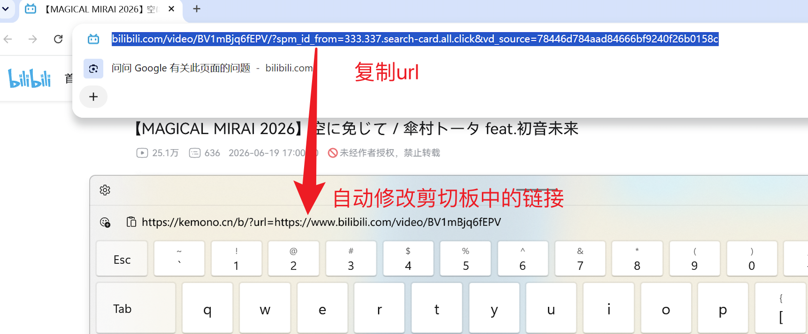
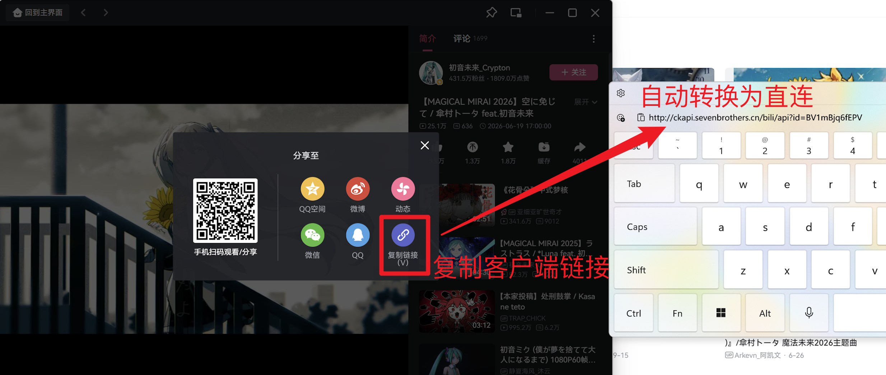
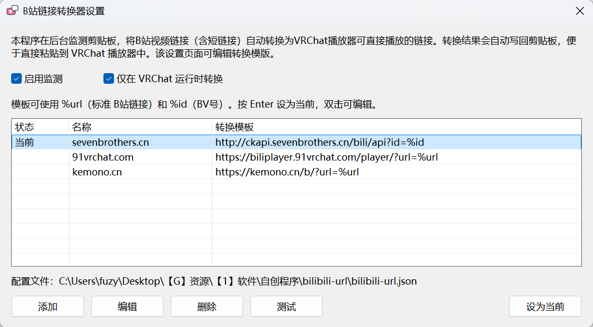

# bilibili-link-converter-for-vrchat

一个面向 VRChat 播放器的 B站链接转换工具，按设置持续监测剪贴板，自动将 Bilibili 视频链接转换为 VRChat 播放器可直接播放的链接。

例如复制：

```text
https://www.bilibili.com/video/BV1mBjq6fEPV
```

使用内置的 `kemono.cn` 规则后，剪贴板会自动变成：

```text
https://kemono.cn/b/?url=https://www.bilibili.com/video/BV1mBjq6fEPV
```



支持从 B站客户端复制的分享文本，包括 `b23.tv` 短链接。



## 细节

程序启动后常驻 Windows 系统托盘。单击托盘图标可打开菜单，双击可打开设置界面。设置界面提供以下功能：



1. 是否启用剪贴板监测（默认开启）。
2. 是否仅在 `VRChat.exe` 正在运行时执行转换（默认开启）。
3. 管理转换模板。模板支持两个占位符：`%url` 表示完整视频链接，`%id` 表示视频 BV 号。程序默认提供三个转换模板，配置保存在程序所在目录的 `bilibili-url.json` 中；如果找不到该配置文件，程序会自动创建默认配置。

## 如何开机自启

请创建程序的快捷方式，并将其放入 Windows 的“启动”文件夹。按 `Win+R` 打开“运行”，输入 `shell:startup` 即可打开该文件夹。

## 从源码构建

原生版本源码位于 `native`，安装 Go 1.27 后运行 `native\build-win-x64.cmd`。构建使用 `CGO_ENABLED=0`，输出为不依赖第三方运行库的 Windows x64 GUI 程序。`native\rsrc_windows_amd64.syso` 内嵌应用 manifest、图标和 VERSIONINFO 版本资源。需要修改这些资源时，先编辑 `native\winres\winres.json`，再运行 `native\generate-resources.cmd` 重新生成资源文件。

## 排查启动问题

启动后程序会发送一条 Windows 托盘通知。Windows 11 可能把新图标放进任务栏右侧的“隐藏的图标”菜单。

如果程序启动失败，会显示错误窗口并记录日志：

```text
%LOCALAPPDATA%\BilibiliUrl\bilibili-url.log
```
